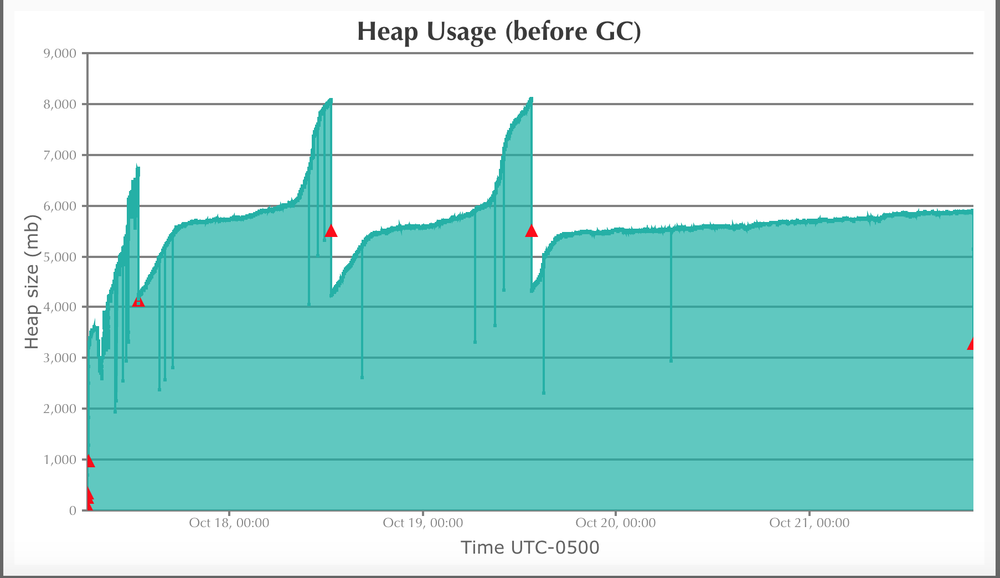
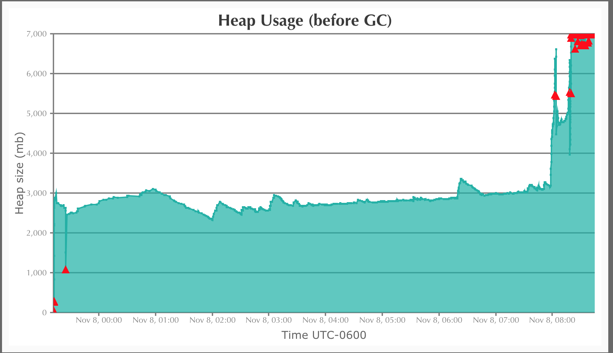
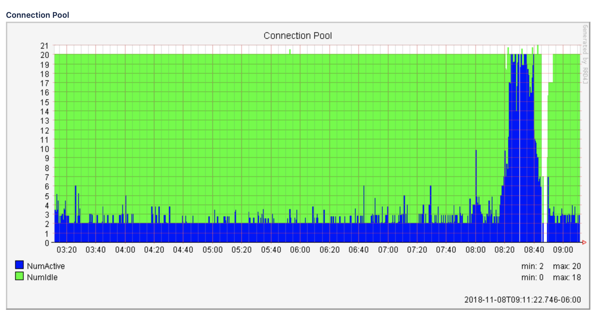
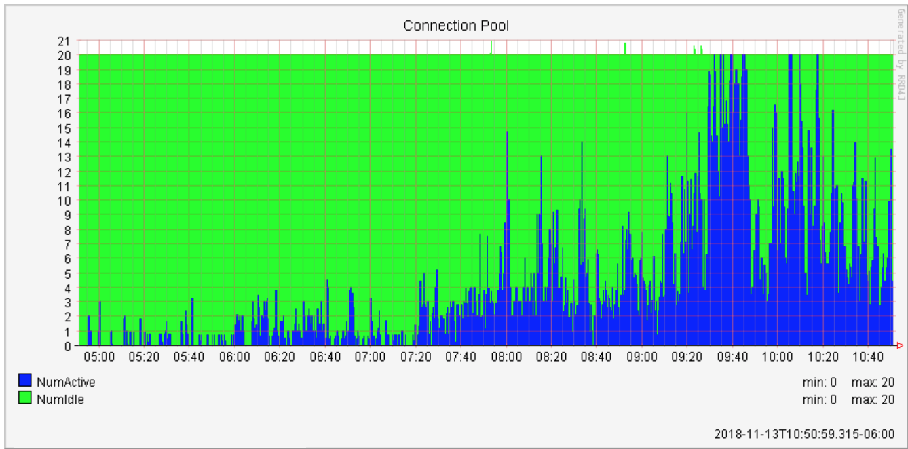
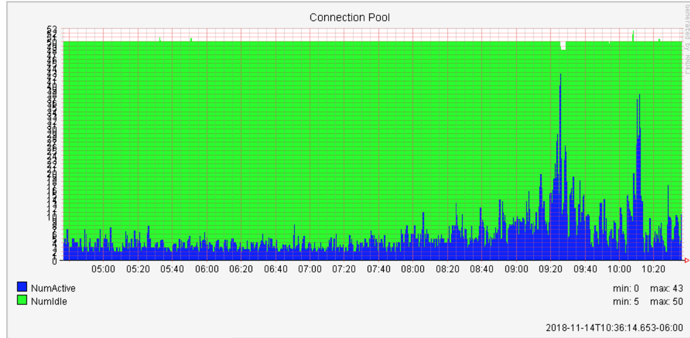
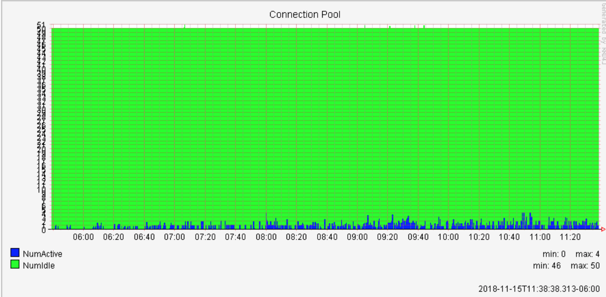
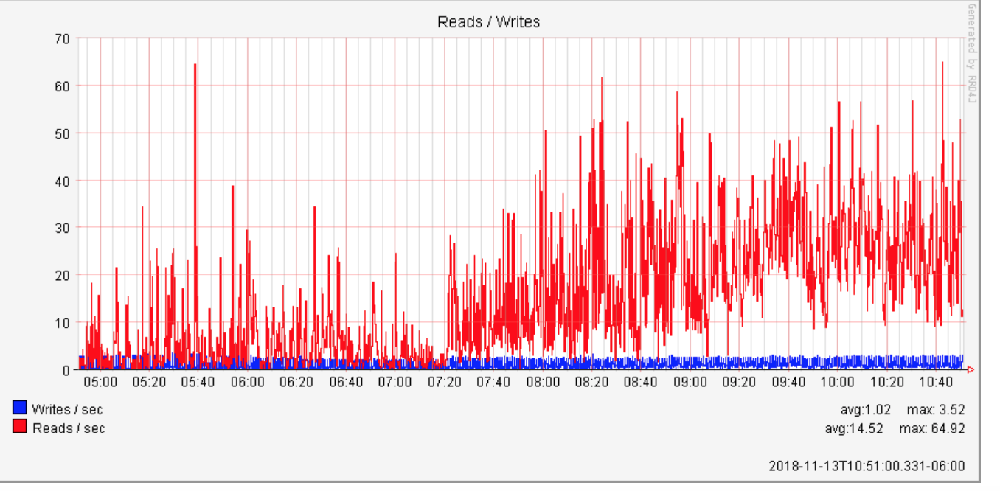
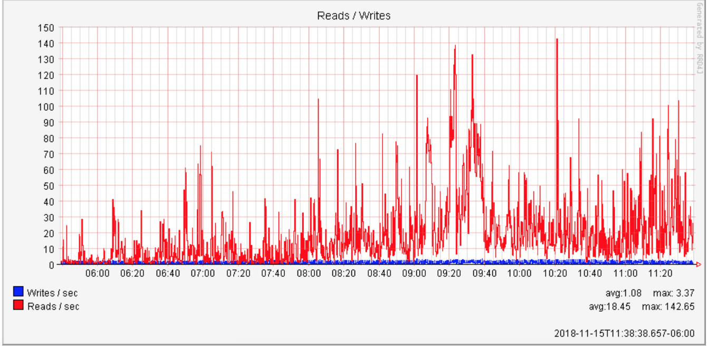

# Case study: fixing a Jira instance that every dashboard said was healthy

A performance engagement I ran in fall 2018 for an enterprise software company. I've removed the client's name, hostnames, people, and project keys. The graphs are the real monitoring output from the engagement, with the client's URL blanked out.

**Bottom line:** the database connection pool went from **fully exhausted (20 of 20)** at peak to **4 of 50**. Over the same period, peak database reads per second more than doubled, from 65 to 143. The system was doing more work with a fraction of the connections.

## The situation

- A single-node Jira 7.12 instance on Windows Server and SQL Server 2016, heavily customized. One project alone held more than half of all issues.
- The application team's log-based KPIs (time to create an issue, time to comment) were degrading about **30% day over day**.
- The only thing holding it together was restarting the application **twice a week**.
- CPU, memory, disk, and the JVM all looked fine on the dashboards. Nobody could find the root cause.

## How I diagnosed it

**1. Baseline the JVM before touching anything.** I pulled garbage-collection logs from before the engagement and kept analyzing them throughout. A healthy heap has a clean sawtooth: memory climbs, GC reclaims it, repeat.



**2. Catch the crash in the act.** On Nov 8, a memory leak took the site down. Heap usage spiked to the ceiling, and each GC cycle just triggered another one.



The logs pointed at an add-on. One monitoring plugin, incompatible with this Jira version, wrote **3,423 log lines in a few hours**, almost all errors. On the same morning, the database connection pool hit its limit.



**3. Find the real bottleneck: the database connection pool, not the hardware.** Even on normal days, active connections pinned the pool at 20 of 20 during working hours. Requests were queuing for a connection, not for CPU. That's why the resource dashboards looked healthy while users suffered.



**4. Use profiling and log analysis to find who was eating the connections.** I enabled Jira's profiling and went through the logs line by line:

- **An external-data custom field** (pulled from another database through an add-on) was queried again and again on every page load. Each query took about 30 ms, but they added up to **more than 3 seconds in a single request**.
- **A CRM sync job** ran every minute.
- **Webhooks** were sending a lot of data nobody used.
- **A ScriptRunner behavior** on the create screen had a hard-coded 1-second `Thread.sleep`, adding a full second to every issue created in that project.
- **Board and dashboard JQL** used expensive functions that ran on every board load (see below).

**5. Rule out infrastructure with benchmarks.** Atlassian's database benchmark came back fine, with every metric under the 20 ms guideline. The filesystem benchmark had normal median times, but max file-open times were **more than 300× the median**. That's the classic sign of antivirus scanning Jira's working directories, so I flagged it as an infrastructure fix.

## What we changed

| Change | Why |
| --- | --- |
| Updated all add-ons and disabled the incompatible monitoring plugin | It was the source of the memory leak and the log flood |
| Cached the external-data custom fields for 60 minutes | Turned thousands of live remote queries into local reads |
| Moved Jira to its own database server and added processors | Stopped Jira from competing with other apps for database resources |
| Raised the database connection pool from 20 to 50 | Mainly as a diagnostic: was 20 a hard ceiling, or a symptom? |
| Cut the CRM sync from every minute to hourly, and cleaned up webhooks | Removed constant background load |
| Rewrote the most expensive JQL behind shared boards | Every board refresh had been running costly functions |
| Flagged the 1-second sleep and antivirus exclusions for the client team | Quick wins on create time and file I/O |

Example JQL fix. Before, with an expensive `subtasksOf()` function and a duplicated clause:

```
project = QA AND "Epic Name" is not EMPTY AND Team = "Platform" AND status != Icebox
OR project = QA AND issueFunction in subtasksOf("project = QA and Team = 'Platform' and status != Icebox")
```

After, with the same results and no function call:

```
project = QA AND Team = "Platform" AND status != Icebox AND type in (subTaskIssueTypes(), Epic)
```

## Results

**Day 1, after raising the pool to 50:** active connections peaked at 43. Raising the cap absorbed the peak, but usage was still high. So the pool size was only a symptom, not the cause.



**Day 2, after caching, isolating the database, and cutting background load:** active connections peaked at **4 of 50**, even at the busiest time of day.



Meanwhile, the database was doing *more* work, because requests that used to sit in a queue were now getting through:

| Database reads / sec | Before | After |
| --- | --- | --- |
| Average | 14.5 | 18.5 |
| Peak | 64.9 | 142.7 |




The JVM stayed healthy even though caching moved some load from the database onto the application server.

| Metric | Before | After all changes |
| --- | --- | --- |
| Peak active DB connections | 20 of 20 (exhausted) | 4 of 50 |
| Peak DB reads / sec | 65 | 143 |

## What I took away

1. **"Healthy" resource graphs can hide a usage problem.** Nothing was short on CPU or memory. The system was choking on how it was being used: chatty integrations, uncached remote lookups, and expensive JQL.
2. **Measure before and after every change.** I raised the pool to 50 first, before the other fixes, so I could test whether 20 was the real limit or just a symptom. It was a symptom, which pointed the work at reducing demand instead of buying hardware.
3. **Count things.** "Lots of errors" doesn't move anyone. "3,423 error lines in a few hours from one plugin" gets the plugin disabled the same day.
4. **Fix the clutter so the problem stays fixed.** The longer-term recommendations were custom field cleanup, JQL review for shared boards, and change management for new configuration. That's what [`health_check.py`](../health_check.py) and [`inventory_queries.sql`](../inventory_queries.sql) in this repo are for.
