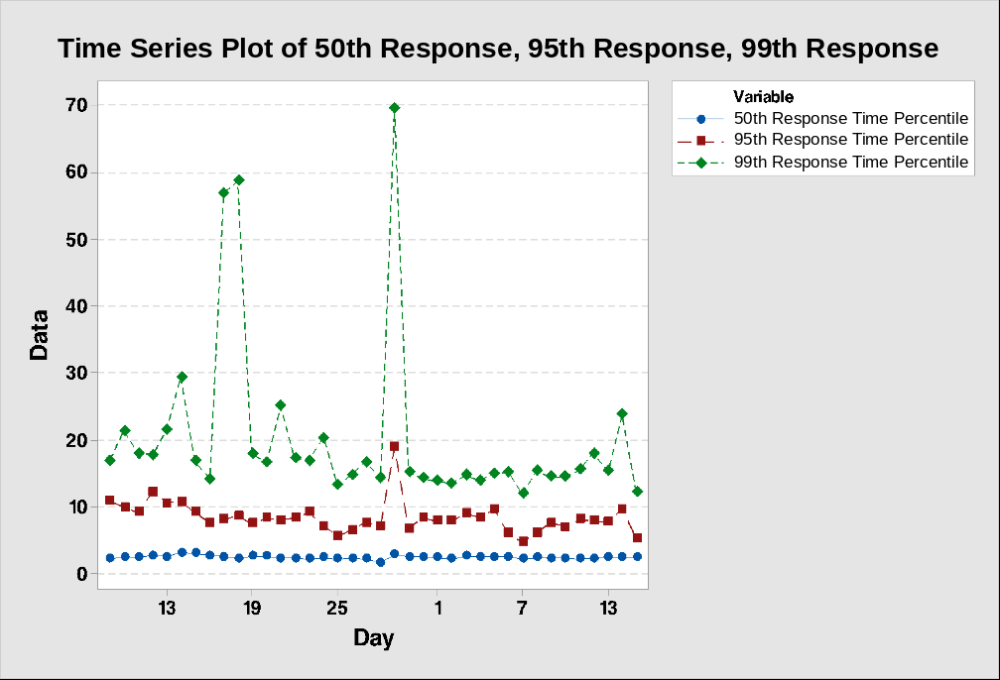
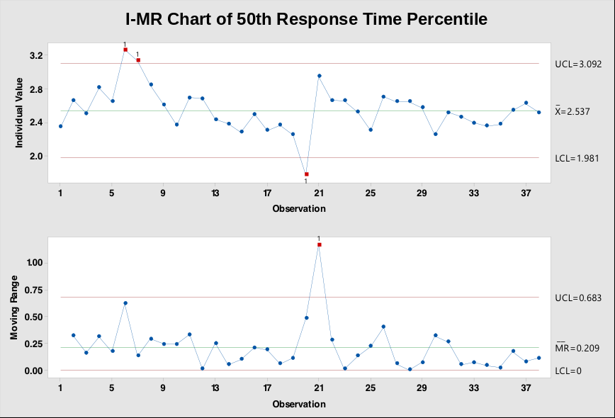
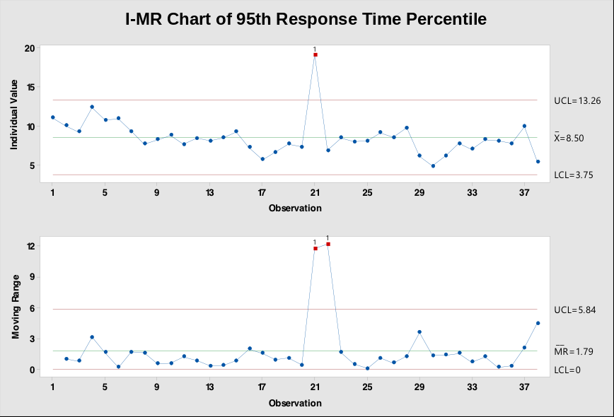
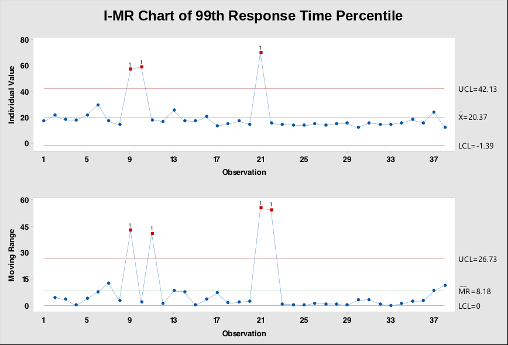

# Case study: what the averages hid

In spring 2019 I ran a performance engagement for a large entertainment company on Jira Data Center, spread across several nodes. Before changing anything, I built a baseline so we'd know what normal looked like. The client's name, hostnames, and people are removed. The charts are the original Minitab output from the engagement. The only edit is a typo I fixed in the chart titles and legend.

**Bottom line:** on a typical day, the median response time barely moved. Meanwhile, the slowest 1% of requests had three days where they ran 3.5 to 4.3 times longer than usual. The worst of those was nearly 70 seconds. Two of those days didn't show up in the median or the 95th percentile at all.

## The data

- 38 weekdays of response times, March through May 2019, across all nodes
- One value per day at the 50th, 95th, and 99th percentiles, in seconds
- Analyzed in Minitab: summary statistics, a time series, and I-MR control charts

## 1. The median looked fine. The tail didn't.

| Daily value, 38 days | Typical day (median) | Worst day | Standard deviation |
| --- | --- | --- | --- |
| 50th percentile | 2.5 s | 3.3 s | 0.26 s |
| 95th percentile | 8.1 s | 19.0 s | 2.4 s |
| 99th percentile | 16.2 s | 69.6 s | 12.9 s |

The median's worst day was 30% above its typical day. The 99th percentile's worst day was more than 4 times its typical day. Plot all three on one chart and the blue line is nearly flat while the green one spikes.

## 2. Control charts showed which days were real problems

A spike on a chart might just be noise. To separate noise from real problems, I used I-MR control charts. The top half plots each day's value. The bottom half plots the moving range, which is how much the value jumped from the day before. Minitab sets the control limits from the average day-to-day change. A red point falls outside those limits, so it isn't normal variation.

**The median (50th percentile)** had tight control limits, about 2.0 to 3.1 seconds. It flagged two slightly slow days and one fast one, all within a second of the mean.

**The 95th percentile** flagged one day: day 21, at 19 seconds against an upper limit of 13.3.

**The 99th percentile** flagged three days. Days 9 and 10 hit 57 and 59 seconds, and day 21 hit 70 seconds, against an upper limit of 42. The moving range flagged the jump into and out of each one.

Days 9 and 10 are the important part. The 99th percentile nearly tripled for two straight days, and **neither the median nor the 95th percentile moved outside its normal range.** If you only watched the average, or even the 95th percentile, that incident never happened. On day 21 all three lines moved, but the median's jump was only about one second. The 99th percentile's jump was 55.

## 3. The node averages hid spikes too

The per-node monitoring told the same story from a different angle. Weekly average response time per node, with the spikes hidden inside those averages:

| Node | Week of 3/27 | Week of 4/3 | Week of 4/10 | Week of 4/17 |
| --- | --- | --- | --- | --- |
| A | 154 ms | 283 ms (spike to 16,000 ms) | 207 ms (spike to 31,000 ms on a dashboard gadget) | 137 ms |
| B | 145 ms | 149 ms | 150 ms (spike to 800,000 ms) | 153 ms |
| C | 145 ms | 247 ms (spike to 4,000 ms) | 197 ms | 144 ms |
| D | 1,010 ms | 1,270 ms | 2,630 ms (spikes averaging up to 7,000 ms) | 3,310 ms |

Node B is the clearest case. Its weekly average sat at about 150 ms for four straight weeks. In one of those weeks, its response time spiked to 800,000 ms, more than 13 minutes. Node D shows the other failure mode: no single dramatic spike, just a steady climb to more than 3 times its starting average in a month.

## 4. Where the time went

Next I sorted the most time-consuming web requests. About 40% of the time went to dashboard gadgets and agile boards. That gave us a concrete place to start.

## What changed because of this

The baseline changed the goal. Lowering the average wasn't the target anymore, because the average already looked fine. The target was getting the top end of response times back under control, and the control limits gave us a way to tell whether a fix actually worked or a good week was just luck.

## What I took away

1. **Look at the tail, not the middle.** Most requests were fine most of the time. The people waiting a full minute were the problem, and the median couldn't see them.
2. **Use more than one percentile.** The 95th percentile missed an incident the 99th percentile caught. Each cut of the data showed problems the others didn't.
3. **Separate noise from signal before reacting.** Control charts made the difference between "that looks like a spike" and "that day was outside normal variation."
4. **A healthy-looking average can be the most misleading number on the dashboard.** This applies anywhere rare failures matter more than typical behavior.
